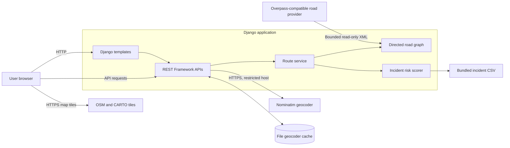
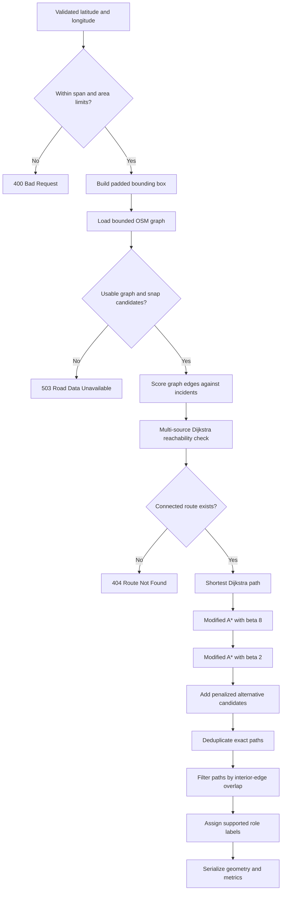
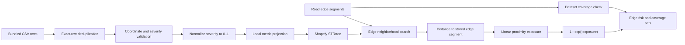
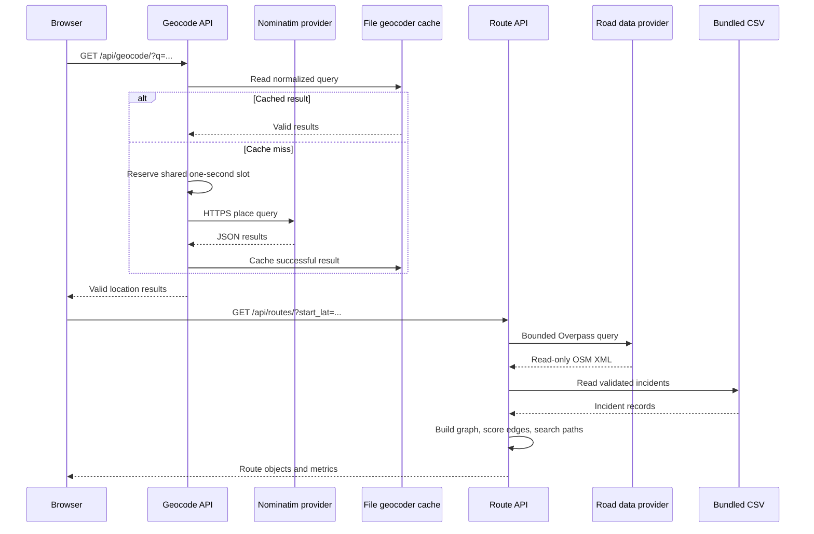
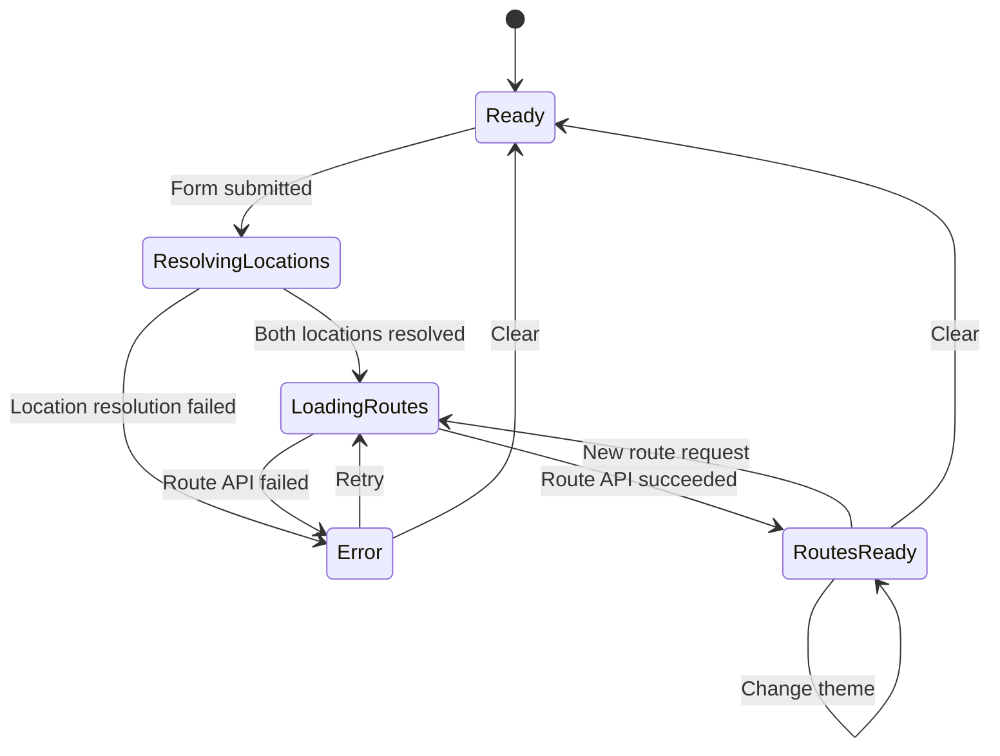
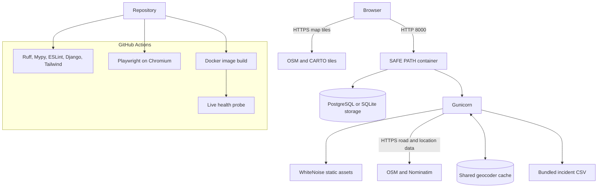

# SAFE PATH Architecture

## 1. Purpose

This document describes the implemented SAFE PATH architecture, from external data acquisition through route calculation and browser rendering. It records the current system rather than a future design.

SAFE PATH uses Django and Django REST Framework for HTTP handling, native JavaScript and Leaflet for the browser, a directed in-memory road graph for routing, and deterministic incident-proximity scoring for safety context. It does not use an LLM, deep learning, or FDL service.

## 2. System context



The browser receives route geometry and metrics through relative API requests. It does not calculate paths or risk. Django does not persist route results and does not enforce HTTP `Origin` headers.

## 3. Backend components

| Component | Source | Responsibility |
| --- | --- | --- |
| HTTP views | `Model/views.py` | Coordinate validation, API serialization, throttling, geocoder cache and pacing, provider errors, health response |
| Route service | `Model/utils/route_service.py` | Candidate generation, objective labels, diversity filtering, route metrics |
| Search core | `Model/utils/routing.py` | Dijkstra, modified A*, path reconstruction, cost validation, exploration limits |
| Graph builder | `Model/utils/osm_graph.py` | Bounded Overpass acquisition, XML limits, access rules, one-way handling, barriers, caching |
| Graph model | `Model/utils/road_graph.py` | Nodes, directed edges, endpoint-segment geometry, distance validation, adjacency indexes |
| Risk scorer | `Model/utils/risk_scoring.py` | Incident validation, spatial index, proximity exposure, risk conversion, coverage |
| Incident loader | `Model/utils/crime_loader.py` | Read and normalize bundled CSV columns |

## 4. Route calculation flow



### 4.1 Request validation

`GET /api/routes/` requires four finite coordinates:

- `start_lat` between `-90` and `90`
- `start_lon` between `-180` and `180`
- `end_lat` between `-90` and `90`
- `end_lon` between `-180` and `180`

Invalid or missing coordinates return HTTP 400. Requests exceeding the configured span or area return HTTP 400. If road data cannot be loaded or a search exceeds its exploration limit, the API returns HTTP 503. A disconnected graph returns HTTP 404.

### 4.2 OSM acquisition and graph construction

The road loader builds a padded bounding box around the requested points. It sends one fixed bounded Overpass QL query for drivable highway classes to the configured HTTPS provider host and rejects redirects, credentials in URLs, non-standard ports, unapproved or known public providers in production, excessive response sizes, non-UTF-8 documents, excessive XML depth, excessive element counts, and prohibited DTD or entity declarations. Provider requests are serialized within one application process.

A single request can be split into smaller bounding boxes only when the provider explicitly reports an oversized area or element count. The request count, aggregate byte count, split depth, and acquisition deadline checked between response reads are bounded.

For each accepted OSM way, the parser:

1. Checks the `highway` class.
2. Resolves access from `motorcar`, `motor_vehicle`, `vehicle`, then `access`.
3. Applies `oneway` direction.
4. Rejects impassable nodes and physical barriers.
5. Creates an edge for every consecutive node pair.
6. Calculates distance from node coordinates.
7. Estimates travel time from road class and `maxspeed` when available.
8. Stores the segment between consecutive OSM nodes and retains way metadata.

The `RoadGraph` rejects an edge whose distance is less than 99% of the endpoint geodesic distance. The parser does not apply OSM turn restrictions or relation-based restrictions, so routes may ignore valid turn bans.

### 4.3 Endpoint snapping

The loader selects nearby graph nodes within the configured snap distance. It first tries the normal padding and then a wider padding if needed. A multi-source Dijkstra search confirms that at least one snapped start candidate can reach a snapped destination candidate.

### 4.4 Search objectives

The search core uses one heap-based implementation for Dijkstra and modified A*.

```text
edge_cost = distance_meters + beta * risk * distance_meters + temporary_penalty
```

The temporary penalty is zero for base paths and is used only while generating alternatives.

The A* heuristic is:

```text
heuristic = 0.99 * geodesic_distance(current_node, goal)
```

Because the graph enforces the same 99% lower bound on edge distance, the heuristic does not overestimate the remaining road distance.

### 4.5 Alternative generation

The candidate pool starts with three objective paths:

| Candidate | Search | Beta |
| --- | --- | --- |
| Shortest | Dijkstra | `0.0` |
| Safety weighted | Modified A* | `8.0` |
| Balanced | Modified A* | `2.0` |

For each base path, temporary edge penalties discourage reuse of that path. Penalized Dijkstra, balanced A*, and safety-weighted A* searches add candidates. Exact edge-sequence duplicates are removed.

Interior-edge overlap is calculated after removing common start and end edges. An alternative is distinct only when its overlap ratio against every selected route is at most `0.75`. The service returns up to four routes. Fewer routes are returned when connected distinct paths do not exist.

### 4.6 Geocoding acquisition

The server validates and normalizes each place query with Unicode NFKC, collapsed whitespace, and case folding. It reads the normalized query from a separate bounded file cache. A cache hit returns immediately without consuming provider capacity. A miss reserves a shared file-lock slot before making an HTTPS request, so Gunicorn workers sharing one instance filesystem start no more than one uncached provider request per second.

The provider request uses an identifying User-Agent, fixed result limit, finite connect and read timeouts, and no redirects. The response is capped at 64 KiB and must be a JSON list; each returned coordinate must be finite and in range. Successful results, including an empty list, are cached for 24 hours by default. Provider failures and malformed payloads are not cached. Cache read and write failures do not block a valid response. A request-lock failure returns HTTP 503 because pacing cannot be guaranteed. The cache directory is created with mode `0700` and must remain owned by the application user because the file cache deserializes local files.

## 5. Incident risk flow



### 5.1 Incident validation

The bundled CSV has 225 raw rows. Exact duplicate rows are removed. A record is accepted only when latitude, longitude, and severity are finite, coordinates are in range, and severity is between 1 and 5. This produces 193 valid unique records.

### 5.2 Proximity exposure

Each incident is projected to a local metric plane around the dataset's reference latitude. A Shapely spatial index limits candidate searches. Distance is measured to the stored straight segment between consecutive edge endpoints.

For an incident at distance `d` from an edge and radius `R=200` metres:

```text
incident_exposure = normalized_severity * (1 - d / R)
```

Incidents farther than `R` do not contribute.

### 5.3 Risk conversion

Exposure from all accepted incidents is aggregated per edge:

```text
edge_risk = 1 - exp(-exposure)
```

The result is bounded from 0 to 1. These edge risks feed the route weighting objective. For a fully covered route, the reported risk is the distance-weighted mean:

```text
route_risk = sum(distance_m * edge_risk) / sum(distance_m)
safety_score = round((1 - route_risk) * 100)
```

The API keeps `risk_score` and `safety_score` names for compatibility. The interface labels them proximity risk and record score and states that they are not a personal-safety assessment. Risk levels are `low` below `0.2`, `moderate` below `0.5`, and `high` otherwise.

### 5.4 Coverage semantics

Dataset coverage is independent of incident magnitude. An edge is covered when its stored segment intersects the bounding area of accepted incidents. A route is fully covered when all of its edge distance is covered.

Fully covered routes can compete for the `safest` label. Partially covered or uncovered routes receive `risk_data_available=false`, `risk_score=null`, `safety_score=null`, and `risk_level="unknown"`. This prevents missing data from being presented as low risk.

## 6. Route labeling

Labels are assigned from actual generated candidates:

| Label | Rule |
| --- | --- |
| `shortest` | The Dijkstra path with minimum road-edge distance |
| `safest` | Lowest computed incident-record proximity risk among fully covered generated candidates; rendered as `Safest by proximity` |
| `balanced` | The modified A* path with `beta=2.0` |
| `alternative` | A retained candidate without a more specific role |

If several objective paths have the same edge sequence, they become one route and receive all supported labels. The API returns only unique route objects.

## 7. API contract



### 7.1 Route object

Key route fields include:

- `id`, `type`, and `labels`
- `algorithm` and `cost_function`
- `node_ids` and `edge_ids`
- `geometry` as latitude and longitude pairs
- `distance_meters`, `distance_km`, `duration_seconds`, and `duration_source`
- `risk_score`, `safety_score`, `risk_level`, and `risk_data_available`
- `incident_coverage_ratio`
- `nodes_explored`, `computation_time_ms`, and `path_cost`
- `diversity.shared_interior_edge_ratio`
- `explanation`

The top-level response includes `origin`, `destination`, `routes`, `route_count`, `incident_data`, `original_route`, `safe_path`, `distance_meters`, `avg_risk`, `nodes`, and `segments`. The final four fields are compatibility summary fields for the shortest route.

## 8. Frontend state



The browser stores only presentation and request state:

- Origin and destination coordinates
- Current route list and selected route ID
- Leaflet route layer group and per-route layers
- Heatmap data, enabled state, and layer
- Current theme and tile layer
- Map point selection mode

Route rendering uses a dedicated Leaflet pane. Route colors are assigned by route order and reused by cards, map lines, and the legend. Theme changes replace the tile layer without rebuilding route or heatmap layers. The interface presents computed values as record score and proximity risk and includes a visible disclaimer that they are not a personal-safety assessment.

## 9. Trust boundaries and safeguards

| Boundary | Safeguard |
| --- | --- |
| Browser to Django | Relative API paths, DRF parsing, coordinate validation, scoped throttling, exact production hosts, HTTPS redirect, secure cookies, no HTTP `Origin` enforcement |
| Proxy to Django | Gunicorn forwarded-scheme handling disabled; explicit Django opt-in for `X-Forwarded-Proto`, only behind a proxy that replaces client-supplied headers |
| Django to OSM | HTTPS host allowlist, explicit production provider approval, no redirects, stream byte limit, request limit, depth limit, UTF-8 and DTD or entity rejection |
| Django to Nominatim | HTTPS host allowlist, identifying User-Agent, no redirects, connect and read timeouts, 64 KiB response limit, response coordinate validation, shared one-second request pacing |
| Incident CSV | Exact-row deduplication, finite value checks, coordinate range checks, severity range checks |
| Routing search | Finite edge values, non-negative beta, endpoint validation, bounded node exploration |
| Browser map | Leaflet and Leaflet.heat pinned and vendored with licenses |
| Container | `/health/` endpoint and Docker health check |
| Django to database | PostgreSQL URL validation, SSL options, persistent connection health checks, or local SQLite |

## 10. Caching and resource bounds

OSM graphs are cached by normalized bounding-box key. Cache entries expire by TTL and the cache has a maximum entry count. Per-graph edge risk scores use a weak-key cache so scores do not outlive their graph unnecessarily. Geocoder results use a separate file cache so workers sharing one instance filesystem reuse successful results without replacing the process-local DRF throttle cache.

Default resource limits include:

- 50 km maximum route span
- 1.0 square-degree maximum route area
- 25,000,000 byte maximum OSM payload per load
- 16 OSM requests per load
- 3 bounding-box split levels
- 8 XML nesting levels
- 500,000 XML elements
- 30 second road-data acquisition deadline checked between response reads
- 100,000 explored nodes per search
- 8 cached graphs
- 24 hour graph cache lifetime
- 1,000 cached geocoder results
- 24 hour geocoder cache lifetime
- 64 KiB maximum geocoder response
- One second minimum between uncached geocoder request starts within one instance

The route API can execute multiple searches per request. Each search has its own exploration limit, while the overall OSM acquisition has shared request, byte, and time budgets.

## 11. Deployment topology



The checked-in container runs Gunicorn as an unprivileged user and serves collected static files through WhiteNoise. It can apply standard Django migrations at startup, while Compose uses a one-shot initializer to repair SQLite volume ownership before the application starts. Compose loads `.env`, including `SAFEPATH_*` values, into the container and binds the application to loopback for a local TLS proxy. `DATABASE_URL` selects PostgreSQL for deployed environments; SQLite and the geocoder cache use the `safepath_data` named volume rather than the host checkout. Production mode requires an exact host allowlist, a strong secret, HTTPS redirects, secure cookies, a customer-owned CARTO publishable key, and explicit trust for forwarded protocol only behind a controlled proxy. A production deployment still needs provider credentials and an appropriate secret-management process.

## 12. Test boundaries

| Layer | Test location | Focus |
| --- | --- | --- |
| Graph unit tests | `web/test_osm_graph.py` | XML parsing, directions, access, barriers, malformed data, limits |
| Routing unit tests | `web/test_routing.py` | Dijkstra, A*, admissibility, distance checks, disconnected graphs |
| Risk unit tests | `web/test_risk_scoring.py` | Proximity, severity, deduplication, malformed rows, coverage |
| Route service tests | `web/test_route_service.py` | Roles, merged labels, alternatives, pairwise diversity, metrics, coverage |
| API contract tests | `web/test_routes_api.py`, `web/test_geocode_api.py`, `web/test_heatmap_api.py` | Validation, status codes, throttling, serialization, provider failures |
| Application smoke tests | `web/test_application.py` | Home page, health endpoint, admin framework, local assets |
| Browser tests | `web/e2e/app.spec.js` | Route rendering, selection, heatmap, themes, errors, console, overflow |

Browser tests use deterministic response fixtures. They validate application behavior without depending on live OSM, Nominatim, tile, or incident service responses.

## 13. Source map

```text
Model/views.py
Model/utils/osm_graph.py
Model/utils/risk_scoring.py
Model/utils/route_service.py
Model/utils/routing.py
Model/utils/road_graph.py
web/templates/web/base.html
web/templates/web/home.html
web/templates/web/partials/route_card.html
web/templates/web/partials/comparison_row.html
web/static/web/js/script.js
web/static/web/css/src/tailwind.css
web/e2e/app.spec.js
web/e2e/fixtures.js
.github/workflows/ci.yml
```
